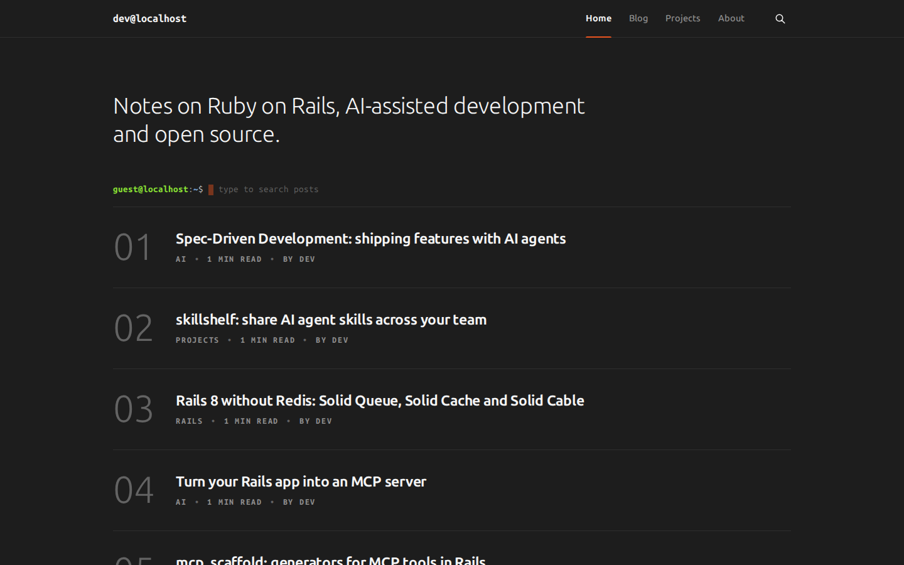
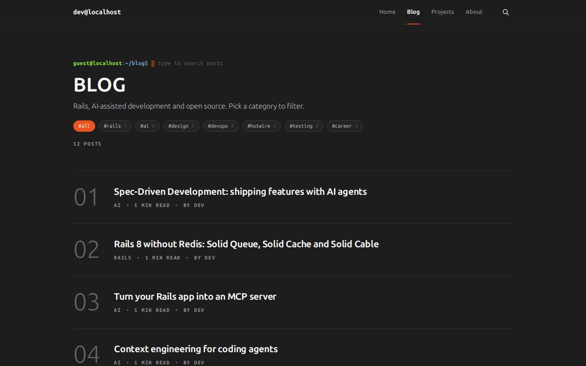
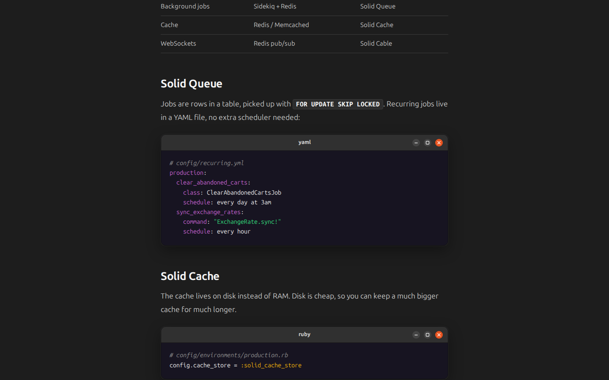
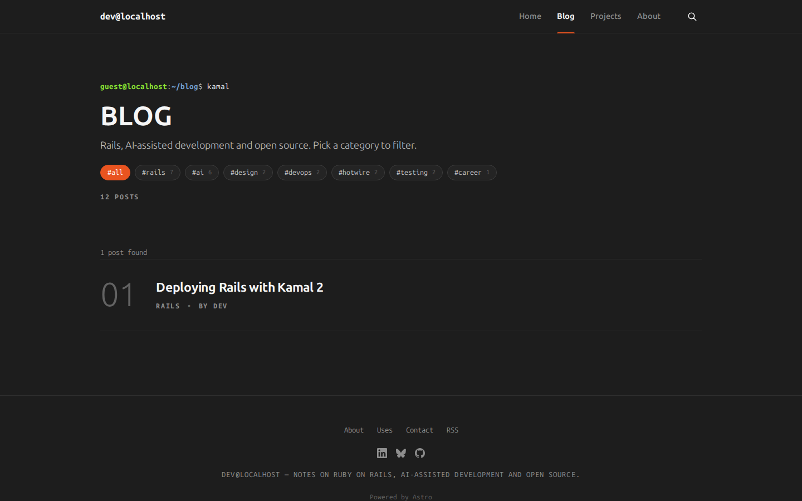
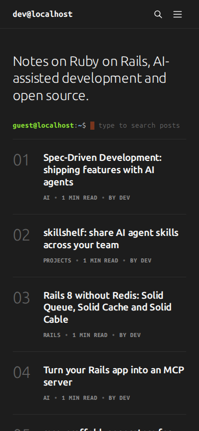

# Yaru (Astro)

A clean, minimal dark blog inspired by Ubuntu 24.04 (Yaru dark): a bash prompt that searches posts, code blocks as GNOME windows, a numbered post list and the Ubuntu orange in the details.

This is the [Yaru Ghost theme](https://github.com/renangabriel27/yaru-ghost) ported to [Astro](https://astro.build). Same look, but a static site: no server and no database, and free hosting on GitHub Pages, Cloudflare Pages or Netlify. Posts are Markdown files in this repository.



| Blog with category pills | Code as a GNOME window |
|---|---|
|  |  |
| **Search in the prompt** | **Mobile** |
|  |  |

## Getting started

```sh
npm install
npm run dev       # http://localhost:4321
npm run build     # static site in dist/
npm run preview   # serves dist/
npm run check     # type-checks the project
```

Requires Node 22.12 or newer.

## Writing posts

Every post is a Markdown file in `src/content/posts/`. Use either `<slug>.md` or a folder `<slug>/index.md` with its images next to it. The file or folder name becomes the URL (`/<slug>/`).

````md
---
title: "Hotwire Native in an afternoon"
excerpt: "Subtitle shown under the title."
date: 2026-10-05
tags: ["hotwire", "rails"]  # slugs from src/data/tags.json; the first one is the primary tag
cover: ./cover.jpg          # optional, optimized by Astro
coverAlt: "Alt text"        # optional
draft: true                 # optional: shows up in `npm run dev` only
---

Your text in **Markdown**.

```ruby
class PostsController < ApplicationController
end
```
````

Other fields: `authors` (slugs from `src/data/authors.json`; defaults to `site.defaultAuthor`), `updated`, `featured` and `coverCaption`.

- **Code blocks** get the language as the window title (`ruby`, `yaml`…) and Prism colors, applied at build time. A block without a language is titled `Terminal`.
- **Pages** like `/about/` live in `src/content/pages/`. They take `title`, `excerpt`, `cover` and `showTitle: false` to hide the header.
- **The blog page**: `/blog/` lists every post except the projects tag, with the category pills. Its title and description come from `src/content/pages/blog/index.md` (the page itself isn't published).
- **Projects**: posts tagged `projects` (`theme.projectsTag`) form a portfolio at `/tag/projects/`. They're left out of `/blog/` and the pills, but still show up on the home page.
- **Tags** are listed in `src/data/tags.json` with `id` (the slug), `name` and `description`.
- **Authors** are listed in `src/data/authors.json` with `id`, `name`, `bio`, `avatar` (path relative to the JSON file), `location`, `website` and `social`.

## Settings

Everything you changed in Ghost Admin now lives in [`src/config.ts`](src/config.ts):

| Ghost Admin | `src/config.ts` |
|---|---|
| Title, description, accent color, language | `site.title`, `site.description`, `site.accentColor`, `site.locale` (`en` or `pt-BR`) |
| Navigation (primary and secondary) | `site.navigation`, `site.secondaryNavigation` |
| Social accounts and the theme's `github_url` | `site.social` |
| Posts per page | `site.postsPerPage` |
| Design & branding options | `theme` (`terminalPrompt`, `projectsTag`, `promptSearch`, `showPostNumbers`, `codeBlocksAsWindows`, `codeStyle` (`'Yaru'` or `'Ray.so'`), `syntaxHighlighting`…) |
| `signup_heading`, `signup_subheading`, `show_post_signup` | `newsletter` (see below) |
| `routes.yaml` (`/blog/` without the projects tag) | `theme.projectsTag` |

## Importing from Ghost

Export your content in Ghost Admin (**Settings → Advanced → Import/Export → Export your content**) and run:

```sh
npm run import:ghost -- path/to/export.json --url https://your-ghost-site.com
```

The script writes posts to `src/content/posts/<slug>/index.md` (with the cover next to it), pages to `src/content/pages/`, tags to `src/data/tags.json` and authors to `src/data/authors.json`. It downloads the images in the content to `public/images/<slug>/`. `--url` resolves the `__GHOST_URL__` placeholders in the export. Existing posts are skipped unless you pass `--force`.

The content becomes Markdown, and code blocks keep their language. Ghost editor cards (callouts, toggles, bookmarks, galleries, buttons, HTML cards) stay as HTML inside the Markdown and keep their styles. The demo posts in this repository came from the Yaru theme's demo content this way.

## Deploying

### GitHub Pages

1. Push this repository to GitHub.
2. In **Settings → Pages**, set **Source** to **GitHub Actions**.
3. Every push to `main` runs [`.github/workflows/deploy.yml`](.github/workflows/deploy.yml) and publishes the site at `https://<user>.github.io/<repo>/`.

For a custom domain or a `<user>.github.io` repository, add the repository variables `SITE_URL` (e.g. `https://blog.example.com`) and `BASE_PATH` (`/`) in **Settings → Secrets and variables → Actions → Variables**.

### Cloudflare Pages or Netlify

Connect the repository. Use build command `npm run build` and output directory `dist`, and set the environment variable `SITE_URL` to the site's address.

## What changed from the Ghost version

- **Members, sign-in and paid content** are gone: a static site has no accounts, so the header has no Sign in/Subscribe buttons. The newsletter block is still there, but posts the email to a newsletter service. Set `newsletter.action` to the form endpoint of Buttondown, ConvertKit or similar. While it's empty, the block is hidden.
- **Search**: the prompt search now reads `/search.json`, generated at build time, instead of Ghost's Content API. It still searches every post (on `/blog/`, every post but the projects), not just the current page. The search button in the header focuses the prompt.
- **Syntax highlighting** runs once at build time (Astro's Prism) instead of in the browser.
- **Comments**: Ghost's native comments aren't available. [Giscus](https://giscus.app) (GitHub Discussions) is a good fit if you want them.
- **RSS** is at `/rss.xml` and the sitemap at `/sitemap-index.xml`.
- **Images**: covers are resized and converted to WebP by Astro at build time.

## Credits

Based on the official [Source](https://github.com/TryGhost/Source) theme (MIT), by way of [Yaru](https://github.com/renangabriel27/yaru-ghost). Editor card styles in `src/styles/cards.css` come from [Ghost](https://github.com/TryGhost/Ghost) (MIT). Fonts: Ubuntu Sans and Ubuntu Sans Mono (SIL OFL). Demo images from [Lorem Picsum](https://picsum.photos).

## License

MIT. See [LICENSE](LICENSE).
